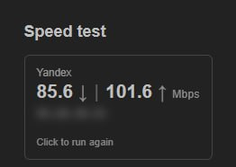

# luci-app-yandex-speedtest

Карточка замера скорости до Яндекса (как [Интернетометр](https://yandex.ru/internet)) на странице
**Status → Overview** в LuCI. Замер идёт с самого роутера: загрузка и отдача в несколько потоков через `curl`.



- клик по карточке запускает тест, повторный клик останавливает;
- узел Яндекса выбирается по наименьшей задержке, задержка показывается на карточке;
- во время теста показывается живая скорость и полоса прогресса;
- внешний IP по умолчанию размыт, клик по нему показывает адрес;
- если API Яндекса недоступен, замер идёт через запасные серверы (Selectel / Ростелеком),
  и на карточке написано, через какие.

> Тест создаёт реальный трафик (десятки и сотни мегабайт). Учитывайте это на лимитных тарифах.

## Установка

Пакеты лежат в [**Releases**](https://github.com/mewmrow/luci-app-yandex-speedtest/releases):

- [последний релиз](https://github.com/mewmrow/luci-app-yandex-speedtest/releases/latest) — стабильная версия;
- [`dev`](https://github.com/mewmrow/luci-app-yandex-speedtest/releases/tag/dev) — сборка последнего коммита.

В описании каждого релиза есть готовые команды: скачать пакеты прямо на роутер и установить.
Нужны два файла: сам пакет и перевод (`luci-i18n-yandex-speedtest-ru`).

OpenWrt 24.10 (opkg, `.ipk`):

```sh
opkg update
opkg install luci-app-yandex-speedtest_*.ipk luci-i18n-yandex-speedtest-ru_*.ipk
```

OpenWrt 25.12 (apk, `.apk`, пакеты без подписи):

```sh
apk update
apk add --allow-untrusted ./luci-app-yandex-speedtest-*.apk ./luci-i18n-yandex-speedtest-ru-*.apk
```

После установки:

```sh
rm -rf /tmp/luci-*; /etc/init.d/rpcd restart
```

`curl` ставится зависимостью.

Новая версия выходит так: поднять `PKG_VERSION` в `Makefile`, затем либо
**Actions → Build → Run workflow** (выбрать ветку) — сборка создаст релиз `vPKG_VERSION` с тегом,
либо запушить тег `vX.Y.Z` с тем же номером.

## Настройки

**Службы → Тест скорости Яндекса** в LuCI или `/etc/config/yandex-speedtest`:

```
config settings 'main'
	option secs '15'          # длительность каждой фазы, 5–60 с
	option streams '3'        # число потоков, 1–8
	option iface ''           # пусто — маршрут по умолчанию; иначе интерфейс (wan, modem) или устройство (wwan0)
	option fallback_down 'https://speedtest.selectel.ru/1GB'
	option fallback_up 'https://speedtest.rt.ru/backend/empty.php'
```

## Проверка и отладка на роутере

Диагностика (ответы API Яндекса, выбранные серверы, короткая проверка загрузки и отдачи):

```sh
/usr/libexec/yandex-speedtest/worker probe
```

Тест без браузера:

```sh
ubus call yandex-speedtest start
ubus call yandex-speedtest status   # повторять, пока state не станет done
ubus call yandex-speedtest stop
```

Состояние лежит в `/tmp/yandex-speedtest/state.json`:

```json
{"state":"idle|prepare|down|up|done|error|cancelled","live":0,"down":null,"up":null,"ping":null,
 "ip":"","server":"yandex|fallback","hosts":"","elapsed":0,"secs":15,"ts":0,"error":""}
```

Коды ошибок: `no-curl`, `down-failed`, `up-failed`, `aborted` (worker завершился посреди теста).

## Как устроено

| Файл | Что делает |
|------|------------|
| `root/usr/libexec/yandex-speedtest/worker` | sh-скрипт замера: зонды Яндекса, потоки curl, живая скорость по счётчикам интерфейса, `state.json` |
| `root/usr/share/rpcd/ucode/yandex-speedtest.uc` | ubus-объект `yandex-speedtest`: `start`, `status`, `stop` |
| `root/usr/share/rpcd/acl.d/luci-app-yandex-speedtest.json` | права: `status` на чтение, `start`/`stop` на запись |
| `htdocs/.../view/status/include/25_yandex_speedtest.js` | карточка на Overview |
| `htdocs/.../view/yandex-speedtest/settings.js` | страница настроек |
| `po/` | перевод |

## Тесты

- `sh tests/worker.sh` — worker против локального сервера с ограничением скорости
  (3 потока × 20 Мбит/с): точность замера, остановка, блокировка, задержка, выбор узла
  по сохранённому ответу Яндекса. Нужны `python3`, `curl`.
- `tests/e2e/` — в CI: настоящий OpenWrt 24.10 и 25.12 (rootfs в Docker), установка пакетов,
  тест через ubus, запасные серверы, UI через Playwright, удаление пакета.
  Скриншоты — в артефактах сборки `e2e-screenshots-*`.

План работ — в [TODO.md](TODO.md).
